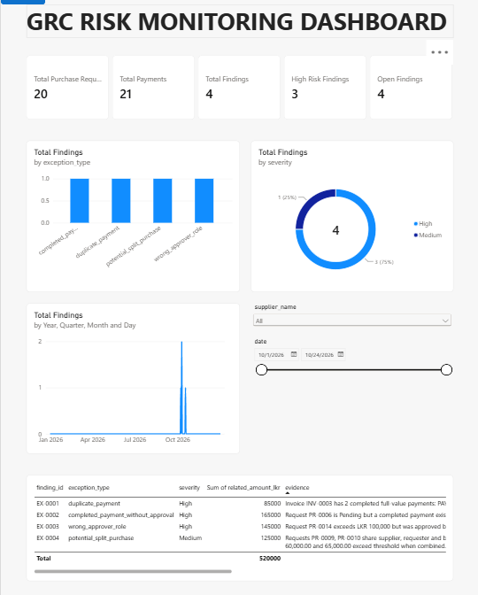
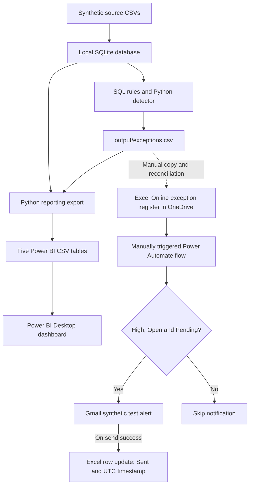
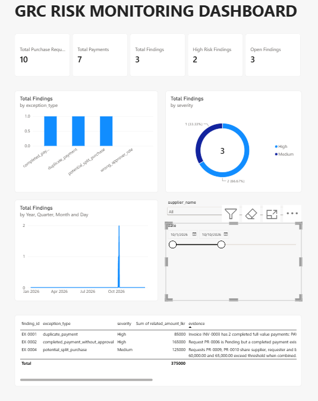
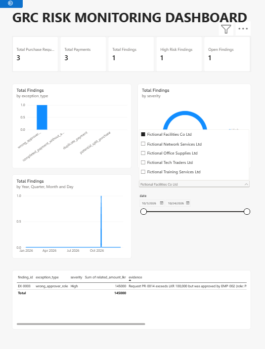
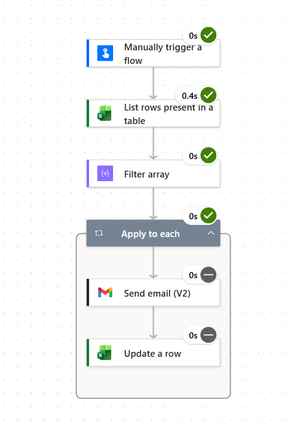

# GRC Risk Monitoring Dashboard with Automated Alerts

**Python · SQL · SQLite · Power BI · Power Query · DAX · Power Automate · Excel Online · Gmail**

A procurement control-monitoring prototype that turns transaction records into reviewable findings, an interactive Power BI dashboard, and test email alerts. It demonstrates translating business policies into SQL rules, reporting tables, workflow automation and repeatable checks.

> **Independent portfolio project using synthetic data only.** Findings require human investigation. Related amounts are associated transaction values, not confirmed fraud or financial loss. The local-to-cloud synchronization step is manual, and Stage 5 manual validation remains **PARTIAL**.

| Purchase requests | Invoices | Payment records | Findings | High / Medium | Open | Recorded local tests |
|---:|---:|---:|---:|---:|---:|---:|
| 20 | 20 | 21 | 4 | 3 / 1 | 4 | 28 passed |

[Run locally](#run-locally) · [Business rules](#business-rules) · [Test evidence](#testing-and-evidence) · [Architecture](docs/ARCHITECTURE_OVERVIEW.md) · [Interview demo](docs/DEMO_SCRIPT.md)



## Business problem and implemented scope

A fictional Sri Lankan company purchases goods and services from suppliers. Employees request purchases, authorized employees approve them, suppliers issue invoices, and finance records payments. An audit reviewer needs to identify control exceptions, understand the evidence and prioritize follow-up.

`Purchase request → Approval → Supplier invoice → Payment → Exception screening → Human review`

The repository contains:

- Reproducible source CSVs for **6 employees, 5 suppliers, 20 requests, 20 invoices and 21 payments**.
- Four SQL rules executed by a Python detector, producing findings with severity, record references, evidence, recommended action and review status.
- Five reporting exports, DAX measures and a saved [Power BI report](powerbi/report/GRC_Risk_Monitor.pbix).
- Documentation and screenshots of a manually configured Power Automate flow that sends synthetic Gmail alerts from an Excel Online register.
- Automated scenario, data-quality and export checks, plus a reconciliation script and a manual evidence report.

The current detector uses deterministic business rules. AI-assisted summaries and LLM evaluation are future extensions.

## System architecture



**Manual boundary:** the local exception CSV, Power BI tables and cloud notification register are separate copies. Local regeneration does not synchronize the OneDrive workbook or preserve its notification state automatically. The working cloud flow and account connections are configured outside this repository.

The [schema](sql/schema.sql) separates employees, suppliers, purchase requests, invoices and payments. A request has at most one invoice in this simplified schema; an invoice can have many payments, which makes duplicate-payment analysis possible. See the [data dictionary](docs/data_dictionary.md) and [architecture overview](docs/ARCHITECTURE_OVERVIEW.md).

## Business rules

All amounts are in **LKR**. The fictional policy requires Manager approval for purchases **above LKR 100,000**, prohibits payment while approval is Pending or Rejected, and calls for investigation of duplicate payments and possible purchase splitting.

| Rule / severity | Implemented detection condition | Baseline example | Main limitation |
|---|---|---|---|
| [R01 — High](sql/detection_rules/duplicate_payment.sql) | At least two Completed payments against one invoice, each equal to its full invoice amount. | `PAY-0003` and `PAY-0021` on `INV-0003` | Partial-payment overpayments, refunds and corrections need additional logic. |
| [R02 — High](sql/detection_rules/completed_payment_without_approval.sql) | A Completed payment exists for a request whose current approval status is not Approved, regardless of amount. | `PR-0006`, LKR 165,000, Pending | Current status alone does not establish approval-before-payment chronology. |
| [R03 — High](sql/detection_rules/wrong_approver_role.sql) | An Approved request exceeds LKR 100,000, has a Completed payment, and its approver is missing or has a role other than Manager. | `PR-0014`, LKR 145,000, ProcurementOfficer | Historical role changes and delegated authority are not modeled. |
| [R04 — Medium](sql/detection_rules/potential_split_purchase.sql) | A pair shares supplier, requester and business need, is within three days, has each amount at or below LKR 100,000, and totals more than LKR 100,000. | `PR-0009` + `PR-0010`, LKR 60,000 + 65,000 | A pair-based screening heuristic; legitimate related requests can also match. |

The runtime detector reads the business records, **never the ground-truth labels**. The separate [test-only fixture](data/ground_truth_FOR_TESTS_ONLY.csv) is used for evaluation. Severity labels prioritize review; a flag does not prove misconduct.

## Power BI dashboard

The report uses three fact tables (`FactRequests`, `FactPayments`, `FactExceptions`) and two shared dimensions (`DimSuppliers`, `DimDates`). It includes five KPI cards, findings by type and severity, an event timeline, a finding-detail table, and supplier/date slicers.

| View | Requests | Payments | Findings | High | Open |
|---|---:|---:|---:|---:|---:|
| Baseline | 20 | 21 | 4 | 3 | 4 |
| 1–10 October 2026 | 10 | 7 | 3 | 2 | 3 |
| Fictional Facilities Co Ltd | 3 | 3 | 1 | 1 | 1 |

The filtered screenshot counts agree with the current exports. Dates have different meanings: requests use `requested_on`, payments use `paid_on`, and findings use the underlying `event_date`. The baseline sum of related finding values is **LKR 520,000**, which is not a confirmed loss and may overlap across findings.

<details>
<summary>View date and supplier filtering examples</summary>





</details>

Build/refresh guidance: [Power BI setup](powerbi/README.md) · [DAX measures](powerbi/DAX_Measures.txt). Full evidence/action readability and supplier-filter reset remain open manual checks in the [Stage 5 report](docs/STAGE5_RESULTS_TEMPLATE.md).

## Power Automate notification workflow

The manually triggered cloud flow:

1. Lists rows from the OneDrive Excel exception register.
2. Filters `severity = High`, `status = Open`, and `alert_status = Pending`.
3. Processes eligible findings in **Apply to each**.
4. Sends a synthetic test notification through the Gmail connector.
5. Updates the Excel row keyed by `finding_id` to `Sent`, with a UTC timestamp, after email success.

The supplied mailbox evidence shows **three test alert subjects**, for `EX-0001`, `EX-0002` and `EX-0003`. The tester confirmed success-only Run after configuration. The original private register attachment showed the three High-risk rows as Sent and the Medium-risk row as Pending; the public cropped copy excludes the address and notification-status columns.

The archived rerun diagram shows skipped email/update actions. **The exact empty-filter output, zero iteration count and no-new-email outcome remain partially evidenced (PA04).** Pending/Sent filtering provides basic sequential rerun suppression by design; delivery and state update are separate actions, so failures or concurrent runs can cause duplicates.



More evidence: [synthetic alert subjects](docs/evidence/stage5/gmail-synthetic-risk-alerts.png) · [cropped Excel register](docs/evidence/stage5/excel-exception-register-redacted.png) · [screenshot index](docs/evidence/stage5/README.md) · [workflow test guide](docs/STAGE5_POWER_AUTOMATE_TESTS.md).

## Technology stack

| Area | Technology | Purpose |
|---|---|---|
| Processing | Python standard library | Fixture generation, rule orchestration, CSV export and reconciliation |
| Data | SQL and SQLite | Relational records, joins and transparent control checks |
| Analytics | Power BI Desktop, Power Query, DAX | CSV import, model preparation, measures and interactive reporting |
| Workflow | Power Automate, Excel Online/OneDrive, Gmail connector | Manual cloud alert prototype and notification-state updates |
| Quality | Python unittest | Detection scenarios, boundary cases, data quality and export checks |
| Development | Git/GitHub; GitHub Actions workflow definition | Version history and local-only synthetic CI setup |

## Run locally

Prerequisites: Git and **Python 3.11 recommended** (the recorded reproducibility run used 3.11.9). Local scripts use only the Python standard library; no package installation is required. Power BI Desktop on Windows is needed to open the `.pbix`. Cloud alerts require separately configured Microsoft and Gmail accounts/connectors.

```powershell
git clone https://github.com/gayashan-indrasankha/grc-risk-monitor.git
cd grc-risk-monitor
```

For a **fresh clone or disposable local fixture checkout**, run:

```powershell
python scripts/generate_sample_data.py
python scripts/setup_local.py
python scripts/check_stage1.py
python scripts/run_queries.py
python scripts/detect_exceptions.py
python scripts/evaluate_stage2.py
python scripts/export_powerbi.py
python -m unittest discover -s tests -p "test_*.py" -v
python scripts/stage5_validate.py
```

`generate_sample_data.py` rewrites the synthetic CSVs; `setup_local.py` deletes and recreates **only** the local `grc_stage1.sqlite` fixture. Do not use regeneration to reset a cloud notification register or replace existing Sent rows with new Pending values.

The local outputs are `grc_stage1.sqlite`, `output/exceptions.csv`, the five `powerbi/data/` CSVs and `docs/stage5_validation_result.json`. The database and local exception CSV are ignored by Git; synthetic reporting inputs are intentionally tracked. Explore `INV-0003` with the query runner or [first_queries.sql](sql/first_queries.sql) to see its two payments.

For an existing prepared baseline, run tests and reconciliation without regenerating source data:

```powershell
python -m unittest discover -s tests -p "test_*.py" -v
python scripts/stage5_validate.py
```

Open [GRC_Risk_Monitor.pbix](powerbi/report/GRC_Risk_Monitor.pbix), update its local CSV source paths if needed, and refresh. The Python commands do not provision a Power Automate flow or cloud connections. Follow the [Power BI guide](powerbi/README.md) and [manual workflow checks](docs/STAGE5_POWER_AUTOMATE_TESTS.md) for those parts.

The schema can also be used for PostgreSQL exploration, importing employees, suppliers, requests, invoices and payments in that order. The current detection pipeline uses SQLite-specific SQL/functions and parameter syntax; an end-to-end PostgreSQL migration would require adaptation.

## Testing and evidence

The recorded local run reports **28 tests passed** and **Stage 5 reconciliation PASS**, with 20 requests, 21 payments, 4 findings, 3 High, 1 Medium and 4 Open. Coverage includes full/cancelled/partial payments, approval roles, threshold and date-window boundaries, referential integrity, table keys and export agreement.

Evaluation exactly matches the **four planted scenarios**: **TP = 4, FP = 0, FN = 0**, giving 100% fixture precision and recall. These values do not estimate performance on real enterprise data.

**Manual acceptance remains PARTIAL.** Refresh, save/reopen and success-only Run after were tester-confirmed. Supplier reset, complete Power BI detail display and focused first-/second-run filter evidence remain open. Gmail failure, post-send Excel failure and concurrent-flow tests remain **Not run**.

- [Stage 5 results, provenance and remaining actions](docs/STAGE5_RESULTS_TEMPLATE.md)
- [Validation JSON](docs/stage5_validation_result.json)
- [Test plan](docs/STAGE5_TEST_PLAN.md)
- [Automated tests](tests/)
- [GitHub Actions workflow](.github/workflows/python-tests.yml): generates synthetic local fixtures, runs tests and reconciles exports without cloud credentials. A hosted CI run has not been verified here.

## Limitations and future work

- **Synthetic, limited data:** four deliberately planted cases cannot establish production effectiveness. Expand independently reviewed positive and negative scenarios.
- **Narrow rules:** approval chronology, refunds, cumulative installment overpayments and historical delegation need richer requirements and checks.
- **Manual cloud synchronization:** preserve delivery state when reconciling exports; sequential finding IDs can change when datasets change.
- **Delivery reliability:** a Gmail success followed by failed Excel update can lead to another send on retry; overlapping runs can select the same Pending row. Stable business identities, durable claiming and a notification outbox are proposed improvements.
- **Review and privacy:** findings require human review. Keep real business data, account identifiers, credentials and unredacted private screenshots out of this public portfolio.
- **Deployment:** there is no production service, enterprise application authentication layer, or deployed AI agent in this repository. The prototype uses local files and account-managed cloud connectors.
- **Possible AI extension:** evidence-linked draft summaries or policy-review assistance could be evaluated later with reusable tests and human approval.

## Repository and learning guide

```text
data/                  Synthetic source CSVs and tests-only ground truth
sql/                   Schema, exploration queries and four detection rules
scripts/               Generation, setup, detection, evaluation, export, validation
output/                Ignored local exception CSV
powerbi/               Report, reporting tables, DAX and setup guide
tests/                 Local unittest suites
docs/                  Data dictionary, architecture, evidence and interview notes
docs/evidence/stage5/   Reviewed screenshot archive
.github/workflows/     Synthetic local pipeline CI definition
```

Start with the [data dictionary](docs/data_dictionary.md), follow a request through its invoice and payments, then inspect the SQL rules and tests. The one-invoice-per-request simplification and one-to-many invoice/payments relationship are intentional learning choices.

For a short walkthrough, use the [3–5 minute demo](docs/DEMO_SCRIPT.md). Further notes: [interview practice](docs/IFS_INTERVIEW_PREP.md) · [CV project entry](docs/CV_PROJECT_ENTRY.md) · [portfolio checklist](docs/STAGE6_CHECKLIST.md).

## Author and project context

Maintained by **Gayashan Indrasankha** as an independent learning and portfolio project demonstrating procurement data modeling, SQL/Python control analytics, Power BI reporting, business-process automation and testing.

The project is relevant to GRC analytics and AI & Automation internship work. It is independent of IFS and does not imply IFS sponsorship, endorsement, employment or access to internal systems. Describe personal contributions and any tools or assistance accurately during a walkthrough.
