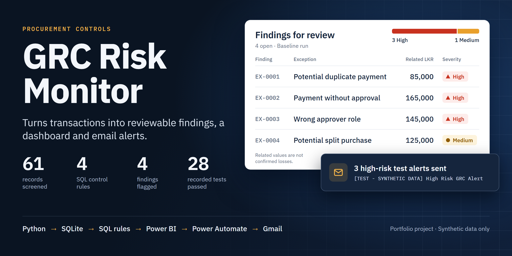
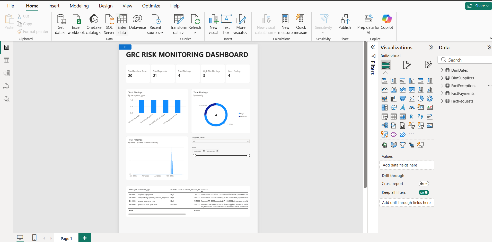
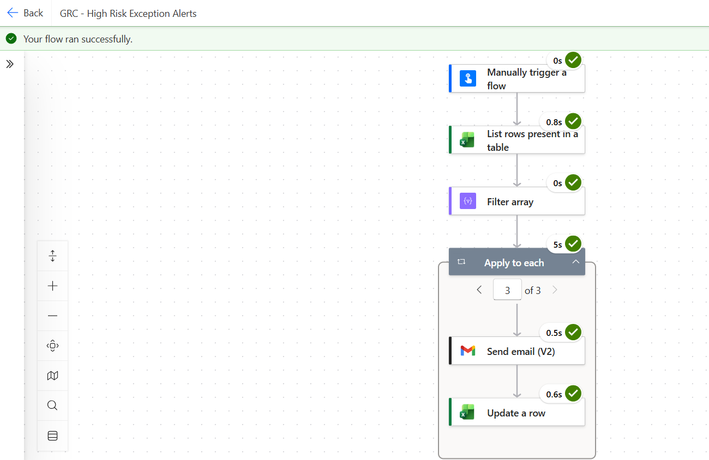
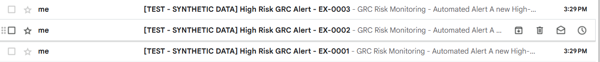
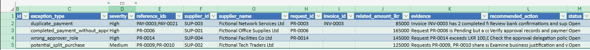
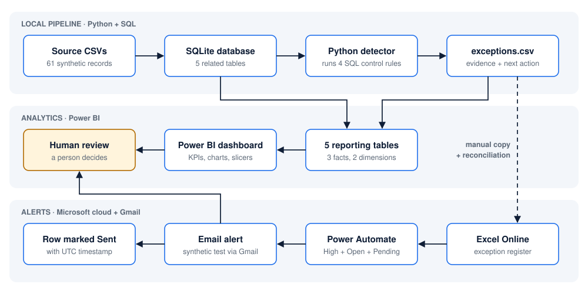
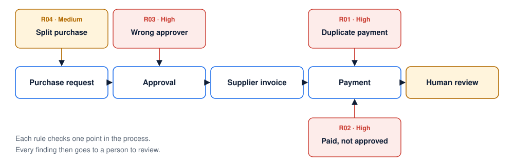
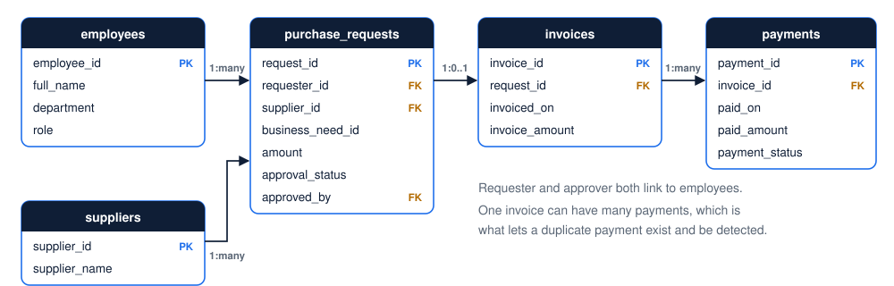
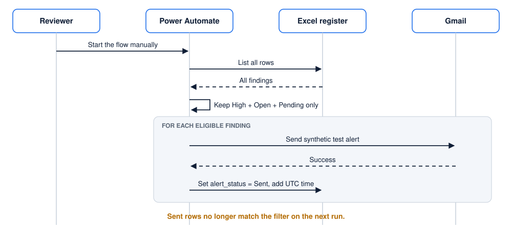

<div align="center">



# GRC Risk Monitoring Dashboard with Automated Alerts

**I turn procurement policy into checks that run: from raw transactions to reviewable findings, an interactive dashboard and email alerts.**

[](https://github.com/gayashan-indrasankha/grc-risk-monitor/actions/workflows/python-tests.yml)


[See it working](#see-it-working) · [How it works](#how-it-works) · [Control rules](#the-four-control-rules) · [Testing](#how-i-tested-it) · [Run it](#run-it-yourself)

</div>

> **Independent portfolio project using synthetic data only.** Suppliers, employees and transactions are fictional. Findings are prompts for human review, not proof of fraud or financial loss.

## The 30-second version

| | |
|---|---|
| **The problem** | A company pays suppliers through a request, approve, invoice and pay process. If an auditor checks those records by hand, a duplicate payment or a skipped approval can easily go unnoticed. |
| **What I built** | An end-to-end monitoring prototype: SQL rules find policy exceptions, Power BI shows where to look, and a Power Automate flow emails a reviewer about each high-risk finding. |
| **The result** | From 61 transaction records, the system flagged 4 findings (3 High, 1 Medium), covering all 4 scenarios I planted, with no false alarms on this test data. |
| **The proof** | 28 automated tests pass, CI runs them on every push to `main`, and exports are reconciled against the source data. |
| **What it shows about me** | I can read a business policy, turn it into precise logic, deliver it in tools people use, and be honest about where it stops working. |

## Why I built this

I wanted to work on the point where business risk meets data. A policy line such as *"purchases above LKR 100,000 need Manager approval"* sounds simple, but turning it into a check forces real questions:

- Does exactly LKR 100,000 count as "above"?
- Should a cancelled payment count as a duplicate?
- If one person raises two requests for LKR 60,000 and LKR 65,000 three days apart, is that splitting a purchase or just normal business?

So I modeled a fictional Sri Lankan company's procurement process, wrote down its policy, and built the whole path from data to a reviewer's inbox. I decided each of those edge cases deliberately, and each one now has a test.

## See it working

These are screenshots of the real project, not mock-ups.

### 1. The dashboard shows where to look first

KPI cards give the overall picture, charts break findings down by type and severity, and the table lists the evidence for each finding.



*The report in Power BI Desktop. The Data pane on the right shows the three fact tables and two dimension tables I modeled.*

### 2. Filters let a reviewer narrow the view

Every visual responds to the supplier and date slicers. I checked the filtered counts against the exported data.

| Filter by date: 1–10 October 2026 | Filter by supplier: Fictional Facilities Co Ltd |
|:--:|:--:|
|  |  |
| 10 requests · 7 payments · **3 findings** | 3 requests · 3 payments · **1 finding** |

### 3. High-risk findings go to a reviewer

My Power Automate flow reads the exception register, keeps only High, Open and not-yet-notified findings, sends an email for each, and records that the alert went out.



*A successful run. "Apply to each" processed three findings, with an email and a register update for each one.*

The alerts from that run arrived in the mailbox, clearly marked as test data:



### 4. Running it again doesn't repeat the alerts

Once a finding is marked `Sent`, the filter excludes it. In this re-run, the email and update steps were skipped:


### 5. The register holds the working list

Each finding carries its type, severity, record references, supplier, value, evidence, recommended action and status.



*Cropped before the reviewer-email and notification-status columns, to keep a real address out of a public repo.*

## How it works



The solid arrows are handled by my scripts and the connected tools. The dotted arrow is a manual step, and I documented it as a boundary: regenerating local data must not overwrite the cloud register's record of which alerts were already sent.

**More detail:** [Architecture overview](docs/ARCHITECTURE_OVERVIEW.md) · [Data dictionary](docs/data_dictionary.md) · [Demo script](docs/DEMO_SCRIPT.md)

### Where each control sits in the business process



### Data model

I separated the source data into five related tables, so each control can trace a payment back through its invoice and request to the person who approved it.



Allowing many payments per invoice is what makes a duplicate payment possible to represent and detect. For the dashboard, I reshaped this into a star schema: three fact tables and two shared dimensions (`DimSuppliers`, `DimDates`), joined by six one-way relationships, so one slicer filters every visual consistently.

### How an alert is sent



## The four control rules

All amounts are in LKR. The fictional policy requires Manager approval above LKR 100,000, prohibits paying a request that is Pending or Rejected, and calls for investigation of duplicate payments and possible splitting.

| Rule | Risk it addresses | What it checks | What it found |
|---|---|---|---|
| [**R01 · High**](sql/detection_rules/duplicate_payment.sql)<br/>Duplicate payment | Paying a supplier twice | Two or more Completed payments on one invoice, each for the full amount | `INV-0003` paid by both `PAY-0003` and `PAY-0021` (LKR 85,000) |
| [**R02 · High**](sql/detection_rules/completed_payment_without_approval.sql)<br/>Paid without approval | Money leaving before authorization | A Completed payment on a request that is not currently Approved | `PR-0006` paid while Pending (LKR 165,000) |
| [**R03 · High**](sql/detection_rules/wrong_approver_role.sql)<br/>Wrong approver role | Approval beyond someone's authority | A paid request above the threshold approved by a non-Manager, or with no approver | `PR-0014` approved by a ProcurementOfficer (LKR 145,000) |
| [**R04 · Medium**](sql/detection_rules/potential_split_purchase.sql)<br/>Potential split purchase | Dodging the approval threshold | Two requests with the same supplier, requester and business need, within 3 days, each at or below the threshold but above it combined | `PR-0009` + `PR-0010` (LKR 60,000 + 65,000) |

R04 is a screening heuristic, which is why I rated it Medium: legitimate related purchases can also match it, so it asks a reviewer to look rather than claiming a violation.

## Decisions I made, and why

| Decision | Why |
|---|---|
| **Transparent SQL rules, not a machine-learning model** | An auditor has to be able to explain why something was flagged. Every finding here traces back to a readable condition and specific record IDs. |
| **Findings include evidence and a next step** | A flag isn't a verdict. Each finding carries its evidence and a recommended action, so the decision stays with a person. |
| **The detector can't see the answer key** | The planted-scenario labels sit in a separate test-only file that the detector never loads, so the evaluation can't be quietly contaminated. |
| **Update the register only after an email succeeds** | If a send fails, the finding stays Pending rather than being marked as notified when nobody was told. |
| **Keep personal details out of public evidence** | I cropped the screenshots here to remove personal addresses, tenant details and account images. |

## How I tested it

| Check | Result |
|---|---|
| Automated tests ([`tests/`](tests/)) | **28 of 28 pass** |
| Planted scenarios | **4 of 4 detected, 0 false positives, 0 missed** |
| Reconciliation across database, exceptions and exports | **PASS** ([result](docs/stage5_validation_result.json)) |
| Hosted CI ([workflow](.github/workflows/python-tests.yml)) | Rebuilds the baseline, runs the tests and reconciles on each push to `main` |

The tests focus on the edge cases where rules usually go wrong:

- **Boundaries:** a request at exactly LKR 100,000 isn't flagged as above the threshold.
- **False alarms:** cancelled and partial extra payments don't count as duplicates, and pairs outside the 3-day window aren't flagged as splits.
- **Fixes clear findings:** correcting the approver to a Manager removes the finding.
- **Data integrity:** foreign keys, unique keys, required values and export totals all agree.
- **Safety:** the detector doesn't modify the database it reads.

**What those numbers don't mean:** 100% on four scenarios I planted shows that the rules do what I designed them to do. It doesn't predict accuracy on real company data.

**What's still open:** manual acceptance testing is recorded as [partial](docs/STAGE5_RESULTS_TEMPLATE.md). Refresh, save and reopen, and the success-only email-to-update path are confirmed. The supplier filter reset and the full display of long evidence text still need checking, and the empty re-run is only partly evidenced. I haven't run the Gmail failure, Excel update failure or concurrent-run scenarios.

## What I'd improve next

| Current limit | What I'd build |
|---|---|
| Rules check current approval status, not whether approval came before payment | Add approval-chronology checks and an approval history |
| Partial overpayments, refunds and delegated authority aren't modeled | Extend the rules, with independently reviewed test cases |
| If an email sends but the Excel update then fails, a retry can send it twice; overlapping runs can too | A notification outbox with stable finding IDs and durable claiming |
| The local-to-cloud sync is manual and the flow starts by hand | A scheduled pipeline that preserves delivery state |
| Four planted scenarios on a small dataset | A larger dataset with more positive and negative cases |
| Reviewers read the raw evidence themselves | AI-drafted summaries linked to evidence, evaluated and approved by a person |

## Skills this project demonstrates

| Skill | Where you can see it |
|---|---|
| **Business analysis and GRC thinking** | Turning a procurement policy into four testable controls with severity levels |
| **SQL and data modeling** | [Relational schema](sql/schema.sql), multi-table joins, self-joins for pair detection |
| **Python** | [Standard-library pipeline](scripts/): data generation, detection, export, reconciliation |
| **BI and data visualization** | [Power BI report](powerbi/report/GRC_Risk_Monitor.pbix), star schema, Power Query, [DAX measures](powerbi/DAX_Measures.txt) |
| **Process automation** | Power Automate flow with Excel Online and Gmail connectors, plus notification state |
| **Quality and testing** | 28 unit and data-quality tests, boundary cases, reconciliation, GitHub Actions |
| **Documentation and judgment** | [Test report](docs/STAGE5_RESULTS_TEMPLATE.md), evidence redaction, clearly stated limits |

## Run it yourself

You need Python 3.11 and Git. There's nothing to install, because the scripts use only the standard library.

```powershell
git clone https://github.com/gayashan-indrasankha/grc-risk-monitor.git
cd grc-risk-monitor

python scripts/generate_sample_data.py          # Create the synthetic records
python scripts/setup_local.py                   # Build the SQLite database
python scripts/detect_exceptions.py             # Run the four control rules
python scripts/export_powerbi.py                # Create the reporting tables
python -m unittest discover -s tests -p "test_*.py" -v
python scripts/stage5_validate.py               # Reconcile the results
```

You should see 28 tests pass and a reconciliation result of `PASS` with 4 findings.

To explore the dashboard, open [`GRC_Risk_Monitor.pbix`](powerbi/report/GRC_Risk_Monitor.pbix) in Power BI Desktop on Windows, update the CSV paths if needed, and refresh ([setup guide](powerbi/README.md)). The cloud flow lives in my Microsoft account rather than this repo; the [workflow test guide](docs/STAGE5_POWER_AUTOMATE_TESTS.md) describes how it's checked.

<details>
<summary><b>Repository structure</b></summary>

```text
data/                Synthetic source CSVs and the tests-only answer key
sql/                 Schema, exploration queries and the four detection rules
scripts/             Generation, setup, detection, evaluation, export, validation
powerbi/             Report, reporting tables, DAX measures and setup guide
tests/               Automated test suites
docs/                Architecture, data dictionary, test report and evidence
.github/workflows/   CI for the synthetic baseline
```

</details>

## About me

I'm **Gayashan Indrasankha**, and I built this project independently to develop my skills in GRC analytics and AI and automation. I'm looking for internship opportunities in these areas, and I'd be glad to walk you through the project.

[GitHub profile](https://github.com/gayashan-indrasankha)
