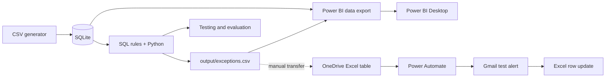

# Architecture & data flow

## High-level design

## Data model

- `employees` stores employee IDs, role, and department used for role checks.
- `suppliers` stores fictional supplier IDs/names.
- `purchase_requests` stores requester, supplier, business need, amount, approval state, approver, and date.
- `invoices` stores invoice IDs and their corresponding purchase requests.
- `payments` stores potentially multiple payments against each invoice, including amount, status and date.
- `FactRequests`, `FactPayments`, `FactExceptions`, `DimSuppliers`, `DimDates` are Power BI exports, not the primary transactional database.

## Trust boundaries

1. **Source data boundary:** All company/supplier/employee records are fictional.
2. **Detection boundary:** SQL and Python flag *investigation leads*; they do not verify wrongdoing.
3. **Presentation boundary:** Power BI reports values from local exported CSVs, which may differ from the cloud Excel register until deliberately synced.
4. **Notification boundary:** Power Automate reads OneDrive Excel; the Gmail connector sends a message to a test recipient. The flow should record `Sent` only after a successful send action.
5. **Failure boundary:** A send and Excel status update are not atomic. Errors or parallel processing can produce duplicate alerts.

## Business rule summary

- R01: Multiple completed **full-value** payments against one invoice.
- R02: Completed payment associated with a purchase request not marked Approved.
- R03: Paid purchase request > LKR 100,000 with an approver not holding the required Manager role.
- R04: Same requester/supplier/business need, two requests within 3 days, individually <= LKR 100,000, together > LKR 100,000.

The simplified synthetic logic does not model all real payment/approval exceptions. Evidence must be checked by an authorized human reviewer.

## Future engineering improvements

- Stable, business-keyed finding IDs and reconciliation on reimports.
- Durable notification outbox with per-finding delivery attempts, errors and retry policy.
- Controlled scheduling with overlapping-run prevention, correlation IDs and replay tests.
- Stronger role delegations and approval chronology checks.
- Larger, independently labeled synthetic/realistic evaluation cases.
- Documented configuration and connection reuse with sensitive values excluded from source control.
